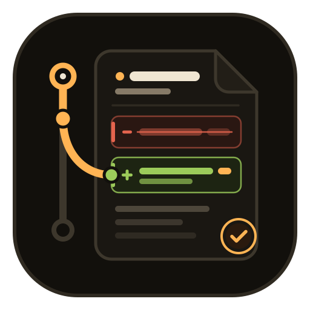
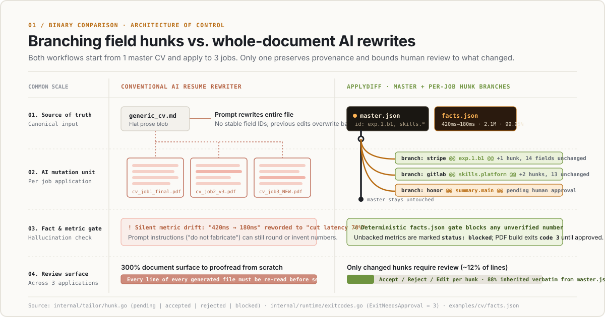
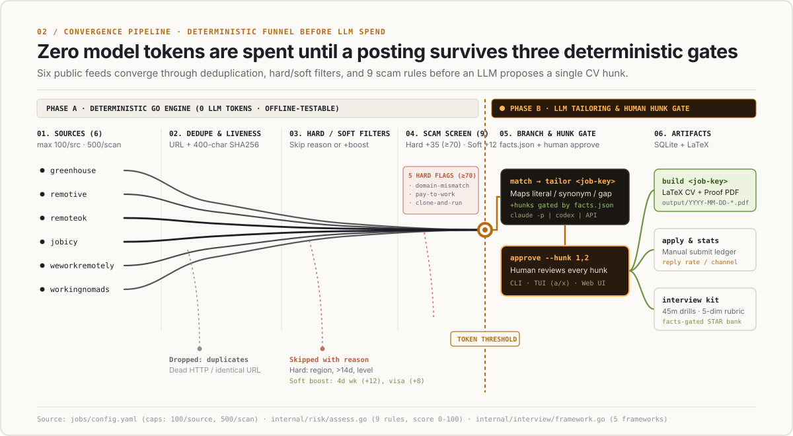
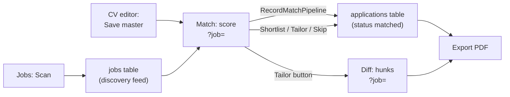
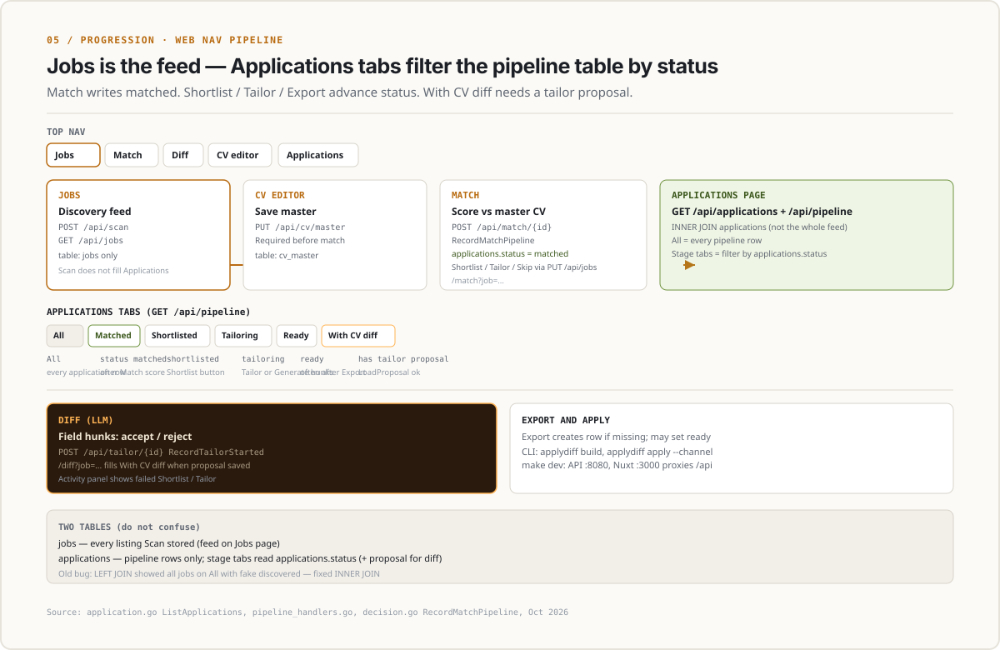

<p align="center">
  
</p>

#  ApplyDiff

**git diff for your CV.**

You rewrite your CV for each job. Then you forget what changed. You can't compare versions. Next time you start from the same generic file.

ApplyDiff is local-first job search, CV tailoring, and interview prep in one binary (CLI, TUI, and Web). It scans job boards without spending model tokens. It scores each posting against your structured CV. You review every AI edit hunk by hunk before it goes into the PDF. Applications and interview loops live in one SQLite file on your machine.

[Quick start](#quick-start) · [How it works](#how-it-works) · [Web UI flow](#web-ui-flow-jobs--match--applications--diff) · [How to use](#how-to-use) · [Comparison](#how-applydiff-compares) · [CLI reference](#cli-commands)

<!-- DEMO GIF: scan -> diff -> approve -> build. 15s, no narration. -->

## Why

Most AI job tools chase volume. They rewrite the whole resume, fill the form, and send 300 applications into silence. You lose track of what changed. You can't check if a number was made up. Next time you start over from the same generic file.

ApplyDiff is built for control:

- **Every application is a branch.** Your master CV (`cv/master_cv.json`) stays as-is. Each job gets its own branch off master.
- **Every edit is a hunk.** The model suggests field-level hunks (`@@ summary @@`, `@@ exp.gofood.b1 @@`, `@@ skills.backend @@`) with a reason and supporting facts. You don't get a full rewrite to proofread from scratch.
- **You approve every hunk.** Accept, reject, or edit each hunk in the CLI, the keyboard TUI, or the Web UI. Only approved hunks go into `output/<date>-<company>-<role>.pdf`.
- **`facts.json` blocks fake numbers.** If a number is not in your verified facts file, the facts check drops it.

<p align="center">
  
</p>

### What ApplyDiff will not do

- **Submit for you.** `applydiff apply` only records that you applied, and through which channel. You click Submit.
- **Invent numbers or skills.** Missing requirements show up as `gap`. They are not stuffed into the CV.
- **Scrape behind a login.** Sources use public applicant tracking system (ATS) APIs and RSS/JSON feeds, with caps and dedupe. Full list: [docs/references/sources.md](docs/references/sources.md).
- **Call home.** No account, no cloud sync, no telemetry. Your CV, branches, hunks, and tracker live in one local `applydiff.db` SQLite file.

---

## How it works

<p align="center">
  
</p>

### Three surfaces, one core

| Surface | Command | Best for |
|---|---|---|
| **CLI** | `applydiff <command>` | Scripts, cron scans, pipes (`--json`, `--dry-run`) |
| **TUI** | `applydiff tui` | Fast hunk review and timed interview drills, keyboard only |
| **Web** | `applydiff serve` | Side-by-side paper CV preview, inline hunk buttons, the full pipeline |

All three call the same Go core in `internal/` and share one SQLite file (`applydiff.db`). The UI has no business logic.

### Web UI flow (Jobs → Match → Applications → Diff)

Local dev: `make dev` (API on `:8080`, Nuxt on `:3000` with `/api` proxied). Embedded UI: `make web && make serve`.



<p align="center">
  
</p>

| Tab | What it is | When a role shows up |
|-----|------------|----------------------|
| **Jobs** | Scanned listings, filters, risk flags | After **Scan** (`POST /api/scan`) — every stored posting |
| **CV editor** | Structured master CV | You click **Save master** (`PUT /api/cv/master`) — required before match |
| **Match** | Fit score + requirements map | Open from a job row (`/match?job=…`); successful score runs **RecordMatchPipeline** → `applications.status = matched` |
| **Applications** | Pipeline tabs (All, Matched, Shortlisted, Tailoring, Ready, With CV diff) | **INNER JOIN** on `applications` only — not every scanned job; sub-tabs filter by status (With CV diff = tailor proposal exists) |
| **Diff** | Per-field CV hunks (accept / reject) | After **Tailor** on Match, or **Generate hunks** on Diff — uses the LLM |
| **Interview** | Kits, mocks, STAR bank | Same pipeline roles; creates an application record when needed |

Brief and QA notes: [docs/visual-briefs/web-pipeline-flow.md](docs/visual-briefs/web-pipeline-flow.md). Scan-only path: [assets/editorial-scan-web-flow.svg](assets/editorial-scan-web-flow.svg).

---

## Quick start

Install a release binary (it embeds the Nuxt 3 web UI and SQLite migrations):

```bash
# macOS / Linux
curl -fsSL https://raw.githubusercontent.com/pahlevikun/applydiff/main/scripts/install.sh | bash

# Windows (PowerShell)
irm https://raw.githubusercontent.com/pahlevikun/applydiff/main/scripts/install.ps1 | iex
```

```bash
# Homebrew (after you publish the tap; see packaging/homebrew/applydiff.rb)
brew install pahlevikun/tap/applydiff

# Scoop (after you publish the bucket; see packaging/scoop/applydiff.json)
scoop bucket add applydiff https://github.com/pahlevikun/scoop-applydiff
scoop install applydiff
```

Then import your master CV and run the pipeline:

```bash
applydiff cv import cv/master_cv.json
applydiff scan
applydiff tui
applydiff serve     # http://localhost:8080
```

**Build from source** (Go + Node):

```bash
git clone https://github.com/pahlevikun/applydiff && cd applydiff
make web && make cli
./bin/applydiff serve
```

Want a one-command walkthrough on sample data? From a git checkout, run `./scripts/demo.sh`.

You don't need an API key if you already have a coding-agent CLI logged in (`claude`, `codex`, `cursor-agent`, or `hermes`). PDF builds use `xelatex` on PATH when available, otherwise [Tectonic](https://tectonic-typesetting.github.io/) (`brew install tectonic`). Set `APPLYDIFF_PDF_ENGINE` to force one engine.

---

## How to use

### 1. Import your master CV and facts

ApplyDiff keeps a structured JSON master CV plus `cv/facts.json` for numbers and claims you have checked. Import loads sibling `facts.json` from the same directory:

```bash
./bin/applydiff cv import cv/master_cv.json
```

If the model suggests a number during tailoring or STAR story writing, and that number is not in your master CV or `facts.json`, the facts check rejects it.

### 2. Pick how the model runs

ApplyDiff looks for a coding-agent CLI on your `PATH` first. If none is there, it falls back to an API key.

**Option A. Coding-agent CLI (recommended, no API key):**

If `claude` (`claude -p`), `codex` (`codex exec`), `cursor-agent`, or `hermes` is on your `PATH`, ApplyDiff uses it. You can also pin a command:

```bash
export LLM_PROVIDER=cli
export LLM_CLI="claude -p"   # or "codex exec", "cursor-agent"
```

**Option B. OpenAI-compatible API:**

```bash
export LLM_PROVIDER=api
export LLM_API_KEY="sk-..."
export LLM_MODEL="gpt-4o-mini"                           # default: gpt-4o-mini
export LLM_API_URL="https://api.openai.com/v1/chat/completions"  # or Ollama / OpenRouter
```

**Option C. Offline fake mode (tests and CI):**

```bash
export LLM_PROVIDER=fake
```

### 3. Set job sources and filters (`jobs/config.yaml`)

Edit `jobs/config.yaml` to turn sources on, add Greenhouse company tokens, and set hard vs soft filters:

- **Hard filters (`hard: true`)** skip listings that don't match, and they say why. Examples: `regions: [SEA, EU, global]`, `arrangement: [remote, hybrid]`, `min_seniority: [senior]`, `max_posted_days: 14`.
- **Soft filters (`hard: false, boost: N`)** keep the listing and bump its score. Examples: `visa_sponsorship`, `eor_friendly`, `async_friendly`, `weekly_days: ["4", "4.5"]`, `salary_min`, `must_have_keywords`.

Preview the HTTP calls without writing to SQLite, or scan with a preset:

```bash
./bin/applydiff scan --dry-run
./bin/applydiff scan --source greenhouse
./bin/applydiff scan --preset aggressive --max-risk 30
```

> The `aggressive` preset keeps only fresh postings (`<= 5 hours` old) with low competition.

### 4. Look at jobs, scam flags, and match scores

List scanned jobs, open one posting, then score it against your master CV:

```bash
# List all scanned jobs (add --json for scripting)
./bin/applydiff jobs

# View the job text, risk/scam flags, and match breakdown
./bin/applydiff show <job-key>

# Score the posting against your master CV (literal / synonym / gap per requirement)
./bin/applydiff match <job-key>
```

### 5. Tailor a branch and review hunks (CLI, TUI, or Web)

Propose a tailored branch for a job, then read the unified diff:

```bash
# Propose field-level hunks for this job
./bin/applydiff tailor <job-key>

# View colored unified diff in the terminal
./bin/applydiff diff <job-key>

# Accept or reject specific hunks (1-based) or approve all
./bin/applydiff approve <job-key> --hunk 1,2
./bin/applydiff reject <job-key> --hunk 3
./bin/applydiff approve <job-key> --all
```

Or review live:

- **TUI** (`./bin/applydiff tui`):
  - `Tab` / `Shift+Tab`: switch screens (`Feed`, `Job`, `Diff`, `Sources`, `Applications`, `Interview`)
  - `j` / `k` or `↑` / `↓`: move across jobs or hunks (`g` / `G` for top/bottom)
  - `/`: filter jobs by title, company, or region
  - `Enter` / `o`: open the selected job
  - `a` / `x` / `Space`: accept, reject, or toggle a hunk on the `Diff` screen
  - `b`: build the LaTeX PDF for the active job branch
  - `?`: keyboard help (`q` to quit)
- **Web UI** (`./bin/applydiff serve`):
  - Open `http://localhost:8080`. Review `+`/`-` marks on the CV sheet, check ATS keyword tags, and click **Accept**, **Reject**, or **Edit** per hunk.

### 6. Build the PDF and log the application

When every hunk is accepted or rejected, build the PDF and record that you applied:

```bash
# Compile output/<YYYY-MM-DD>-<company>-<role>.pdf
./bin/applydiff build <job-key>

# Record your manual application and channel
./bin/applydiff apply <job-key> --mode manual --channel referral --referrer "@alice"

# Reply and interview rates per channel
./bin/applydiff stats
```

### 7. Prep for the interview

Each tracked job can have an interview kit. That includes a predicted loop, 6-step timed system design drills, timed mocks with a 5-dimension rubric, and a STAR story bank that only uses numbers from your facts:

```bash
./bin/applydiff interview kit <job-key>      # Generate per-job interview loop & prep kit
./bin/applydiff interview drill <job-key>    # Run the 6-step timeboxed system design drill
./bin/applydiff interview mock <job-key>     # Start a timed mock session
./bin/applydiff interview story <job-key>    # Draft/view facts-verified STAR stories
./bin/applydiff interview score <job-key>    # Score mock performance across 5 dimensions
./bin/applydiff interview export <job-key>   # Export interview prep pack
```

### 8. Move your database

All state lives in one SQLite file. Copy it to another machine with:

```bash
./bin/applydiff export backup.db
./bin/applydiff import backup.db
```

---

## Features

| Area | What you get |
|---|---|
| **Scan without tokens** | Built-in adapters for **Greenhouse**, **Remotive**, **RemoteOK**, **Jobicy**, **We Work Remotely**, and **Working Nomads**. Dedupe by normalized URL and posting ID. Dead links get dropped before any LLM spend. |
| **Filters** | Hard filters skip with a reason. Soft filters boost the score. Cover work setup, 4-day week, region, timezone overlap, seniority, pay, visa, employer of record (EOR) / contractor, and how fresh the posting is. |
| **Scam screen** | Rule-based flags for email-domain mismatch, pay-to-work fees, ID before interview, clone-and-run malware traps, and missing company domains. Flags warn you. They never hide the listing. |
| **Match** | Scores the posting against your CV. Each requirement is `literal`, `synonym`, or `gap`, with evidence. |
| **Hunk tailoring** | Suggests field edits (`{ field_id, before, after, rationale, evidence[] }`). `facts.json` and the ATS keyword check both apply. |
| **LaTeX PDF and proof page** | Builds ATS-readable PDFs with `xelatex` (`output/<date>-<company>-<role>.pdf`), plus a one-page proof sheet from the same verified facts. |
| **Channel stats** | Tracks `draft`, `ready`, and `applied` across `board`, `referral`, `inbound`, `linkedin`, and `email`. `applydiff stats` shows reply and interview rates per channel. |
| **Interview prep** | Per-job loop, 6-step timed system design, 5-dimension rubric, and a STAR bank that rejects unverified numbers. |

---

## How ApplyDiff compares

ApplyDiff borrows ideas from [`career-ops`](https://github.com/career-ops-hq/career-ops), [`ai-job-search`](https://github.com/MadsLorentzen/ai-job-search), and [`job-sequencer`](https://github.com/chndranndr/job-sequencer). The extra piece is per-hunk diff approval on a branched CV.

| Capability | [ApplyDiff](https://github.com/pahlevikun/applydiff) | [career-ops](https://github.com/career-ops-hq/career-ops) | [ai-job-search](https://github.com/MadsLorentzen/ai-job-search) | [job-sequencer](https://github.com/chndranndr/job-sequencer) |
|---|---|---|---|---|
| **Approval granularity** | **Per-hunk (`accept` / `reject` / `edit` each line change)** | Whole document | Whole document (drafter-reviewer) | Whole document (`Drafting` → `Ready`) |
| **CV version model** | **Master JSON + isolated branch per job** | Markdown `cv.md` | LaTeX `.tex` files | JSON profile + revision artifacts |
| **Surfaces included** | **CLI + TUI + embedded Web UI in 1 binary** | Agent slash commands + Go TUI | Agent slash commands (`/setup`, `/apply`) | React Web UI + Fastify API |
| **Runtime footprint** | **Single Go binary + pure-Go SQLite** | Node.js + Playwright + Go | Python + Bun + Claude Code | Node.js 24 + Bun + Vite |
| **Facts check** | `facts.json` number and claim check | `cv:verify-facts` script | Drafter-reviewer prompt + checklist | Claim validator + factual-auditor agent |
| **Scam and legitimacy check** | Risk rules + score (`0-100`) | Block G posting legitimacy check | Prompt-level untrusted-input rules | Same-run provenance + host allowlist |
| **PDF engine** | LaTeX (`xelatex`) + ATS text checks | HTML + Playwright Chromium | LaTeX (`lualatex` / `xelatex`) + `pdftotext` | LaTeX (`lualatex` / `xelatex`) + `pdfinfo` |
| **Auto-submit** | Never (manual by default) | Never (`You press Submit`) | Never | Never |

---

## Install

| Channel | Command |
|---|---|
| **curl** (macOS / Linux) | `curl -fsSL https://raw.githubusercontent.com/pahlevikun/applydiff/main/scripts/install.sh \| bash` |
| **PowerShell** (Windows) | `irm https://raw.githubusercontent.com/pahlevikun/applydiff/main/scripts/install.ps1 \| iex` |
| **Homebrew** | `brew install pahlevikun/tap/applydiff` (tap repo required; template in `packaging/homebrew/`) |
| **Scoop** | `scoop bucket add applydiff <your-bucket-url>` then `scoop install applydiff` (template in `packaging/scoop/`) |
| **GitHub Releases** | Download `applydiff_<version>_<os>_<arch>.tar.gz` or `.zip` from [Releases](https://github.com/pahlevikun/applydiff/releases) |

Set `INSTALL_DIR` to change the install location (default `~/.local/bin`). Pin a version with `APPLYDIFF_VERSION=1.0.0`.

**Docker (Web UI + API + CLI + TeX Live in one image).**

```bash
docker build -t applydiff .
docker run -p 3000:3000 -v ~/.applydiff:/data applydiff
```

**From source.** `make web && make cli`. See [Development & verification](#development--verification).

---

## CLI commands

```text
applydiff cv import <path>          Import structured master CV (and sibling facts.json)
applydiff scan                      Pull jobs from configured sources (--source, --preset, --min-risk, --max-risk)
applydiff jobs                      List scanned jobs with filter scores and keep/skip decisions
applydiff show <job-key>            Show job details, risk flags, and match breakdown
applydiff match <job-key>           Compute requirement match score against master CV
applydiff tailor <job-key>          Propose field-level tailoring hunks (LLM)
applydiff diff <job-key>            Render unified diff per hunk (--color auto|always|never)
applydiff approve <job-key>         Accept hunks (--hunk 1,2 or --all)
applydiff reject <job-key>          Reject hunks (--hunk 3)
applydiff build <job-key>           Compile LaTeX PDF for an approved branch into output/
applydiff apply <job-key>           Record application submission (--channel, --referrer, --mode)
applydiff stats                     Show reply and interview conversion rates per channel
applydiff interview <subcommand>    kit | mock | drill | story | score | list | export
applydiff tui                       Launch the interactive Bubble Tea terminal UI
applydiff serve                     Launch the embedded Web UI and HTTP API (--port 8080)
applydiff export <file>             Export SQLite database snapshot to a file
applydiff import <file>             Import SQLite database snapshot from a file
```

Global flags: `--json` (JSON on stdout for scripts and pipes) · `--dry-run` (preview, don't write to SQLite).

Exit codes: `0` ok · `2` no match · `3` needs approval · `4` LLM error · `5` LaTeX error.

## Environment

| Variable | Purpose |
|---|---|
| `DATABASE_PATH` | SQLite file path (default `applydiff.db`) |
| `JOBS_CONFIG` | Job sources and filters YAML (default `jobs/config.yaml`) |
| `PORT` | HTTP port for `applydiff serve` (default `8080`) |
| `OUTPUT_ROOT` | PDF output directory (default `output/`) |
| `FACTS_PATH` | Verified facts JSON (default `cv/facts.json` in repo, else `facts.json` under data home) |
| `MASTER_CV_JSON` | Structured master CV JSON (default `cv/master_cv.json`) |
| `MASTER_CV_TEX` | Master CV LaTeX source (default `cv/master_cv.tex`) |
| `LLM_PROVIDER` | `cli` (auto-detected), `api`, or `fake` (offline) |
| `LLM_CLI` | Coding-agent command when `LLM_PROVIDER=cli` (e.g. `claude -p`, `codex exec`) |
| `LLM_API_KEY` | API key when `LLM_PROVIDER=api` |
| `LLM_MODEL` | Model name when `LLM_PROVIDER=api` (default `gpt-4o-mini`) |
| `LLM_API_URL` | Chat completions URL when `LLM_PROVIDER=api` |
| `APPLYDIFF_PDF_ENGINE` | Force `xelatex` or `tectonic` (default: `xelatex` if on PATH, else Tectonic) |

---

## Project structure

```text
applydiff/
├── cmd/applydiff/          # Unified CLI, HTTP API server, and Bubble Tea TUI entrypoint
├── internal/
│   ├── source/             # Job board adapters (greenhouse, remotive, remoteok, jobicy, wwr, workingnomads)
│   ├── scan/               # Bounded scanner orchestration & deduplication
│   ├── filter/             # Hard/soft filter evaluator & presets (e.g. aggressive)
│   ├── risk/               # Deterministic scam & legitimacy rule engine
│   ├── match/              # CV requirement matcher (literal / synonym / gap)
│   ├── tailor/             # LLM hunk generator, parser, facts gate, and ATS checker
│   ├── interview/          # Interview loop kit, 6-step drill timer, rubric, STAR story bank
│   ├── store/              # Pure-Go SQLite persistence & timestamped SQL migrations
│   ├── webembed/           # Embedded Nuxt 3 static build served by `applydiff serve`
│   └── runtime/            # Shared application service layer (used by CLI, TUI, and Web)
├── web/                    # Nuxt 3 frontend (Jobs, Match, Diff, My CV, Interview, Sources)
├── jobs/config.yaml        # Declarative sources, search queries, and filter rules
├── cv/                     # Master CV: master_cv.json, master_cv.tex, facts.json
└── scripts/                # demo.sh walkthrough and release.sh cross-compiler
```

## Development & verification

Run the tests without live LLM credentials or an extra database:

```bash
make test       # Run all unit, migration, filter, risk, TUI snapshot, and API tests (go test ./...)
make web        # Build the Nuxt 3 frontend into internal/webembed/public
make cli        # Build bin/applydiff with embedded assets
make docker     # Build the self-contained Docker image (UI + API + TeX)
make release    # Local cross-compile into dist/ (CI uses GoReleaser on tag push)
make release-snapshot  # Local GoReleaser dry run (requires goreleaser CLI)
```

Migrations are timestamped SQL files in `internal/store/migrations/`.

## License

MIT.
