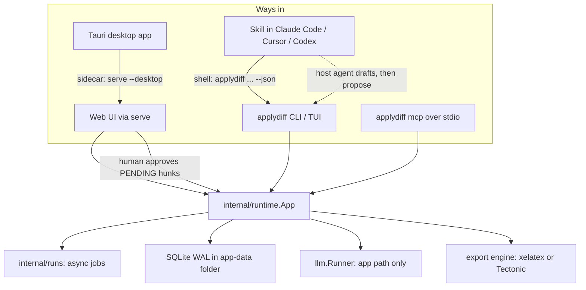

# Standalone applydiff: one core, three ways in

## Decisions locked in the brainstorm

- **Install:** the CLI via Homebrew, Scoop and `install.sh`, plus a Tauri desktop app that runs the Go binary as a sidecar. No Docker, and no manual migrations (`runtime.Open` already runs `st.Migrate`).
- **PDF:** Tectonic, but only after a throwaway spike passes. The Docker fallback is removed once it does.
- **Agents:** skills, MCP and the app are all in scope. Skills come first (the pattern used by career-ops and ai-job-search). MCP is a thin layer over the same core.
- **Who drafts:** in a skill or MCP session, the host agent drafts (`tailor --context`, then `propose`). In the app, applydiff's own runner drafts. Either way, hunks land as PENDING.
- **Approval gate:** layered. The skill hands off for approval, plugin hooks deny `approve|reject|build|apply`, the CLI requires a terminal (or `--confirm`) for those commands, and every action records who did it.
- **Long-running work:** async runs with a run ID plus `get_run`.
- **Hooks:** editor plugins bundle the skill, the MCP config and a session-start hook that installs or checks the binary.
- **Data:** one per-user OS app-data folder shared by the CLI, TUI, web UI, desktop app, MCP and skills. SQLite runs in WAL mode with a busy timeout.

## Architecture



Rule: no surface has business logic of its own. CLI commands, MCP tools and HTTP handlers all call the same `runtime.App` methods.

## Interface sketch (architect phase)

New core methods, built from existing public functions in [internal/tailor/tailor.go](internal/tailor/tailor.go) (`BuildPrompt`, `ValidateHunks`) and [internal/runtime/tailor_hunks.go](internal/runtime/tailor_hunks.go):

```go
// internal/paths
type Paths struct{ Home, DB, Config, Facts, Output, Bin string }
func Resolve() (Paths, error) // env overrides > legacy ./applydiff.db > OS app-data folder

// internal/runtime
type TailorContext struct {
    Job    job.Job
    Fields []cv.FieldView // field_id, section, current text
    Facts  *cv.Facts
    Rules  string         // the BuildPrompt instructions, minus the transport wrapper
    Schema string         // JSON schema for RawHunk[]
}
func (a *App) TailorContext(ctx context.Context, key string) (*TailorContext, error)
func (a *App) ProposeHunks(ctx context.Context, key string, raw []tailor.RawHunk, actor Actor) (*store.Proposal, error)
func (a *App) AddJob(ctx context.Context, in AddJobInput, actor Actor) (*job.Job, error) // pasted JD; runs extract.FromText + risk check

// internal/runs (new migration 20260101000010_runs.sql)
type Run struct{ ID, Kind, JobKey, Status, ResultJSON, Error string; Created, Updated time.Time }
func (r *Runner) Start(ctx context.Context, kind string, key string, fn func(context.Context) (any, error)) (Run, error)
func (r *Runner) Get(ctx context.Context, id string) (Run, error) // runs left "running" on startup become failed

// internal/export
type Engine interface{ Compile(texPath, workDir, pdfPath string) error }
func ResolveEngine(p paths.Paths) (Engine, error) // configured > xelatex on PATH > tectonic (bundled, cached, or downloaded)

type Actor string // "human", "agent:<client>", "cron"
```

New CLI commands: `add`, `tailor --context`, `propose <job> --hunks -`, `tailor --async`, `runs get <id>`, `open [job]`, `doctor`, `init`, `mcp`, `mcp install cursor|claude|codex`.

## Phase 0: Run from anywhere (unblocks everything)

- Add `internal/paths`. Point [internal/runtime/app.go](internal/runtime/app.go) at it instead of the hard-coded `applydiff.db`, `jobs/config.yaml` and `facts.json`.
- Embed a default `jobs/config.yaml` and write it on first run, so `jobconfig.Load` never fails because the file is missing.
- In [internal/store/store.go](internal/store/store.go), open SQLite with `_pragma=journal_mode(WAL)&_pragma=busy_timeout(5000)`.
- Add `applydiff doctor --json` (data folder, DB, LLM provider, PDF engine, MCP registration) and `applydiff open` (start `serve` if it isn't running, then open the browser at the job's diff page).
- When started by the desktop app, load the login-shell PATH before `llm.DetectCLI`. Otherwise GUI launches miss `claude` and `codex` and quietly fall back to `fake`.

## Phase 1: Tectonic spike, then a pluggable PDF engine

- Throwaway branch first. Compile the CV, cover letter, proof and interview-prep templates with Tectonic on macOS, Linux and Windows. Measure the first-run package download, offline rebuilds from the cache, and binary size.
- Known risk: [internal/interview/prep_pdf.go](internal/interview/prep_pdf.go) uses `\setmainfont{DejaVu Sans}`, which a stock Mac doesn't have. Bundle the font and load it with fontspec `Path=`.
- If the spike passes, replace `CompilePDF` in [internal/export/latex.go](internal/export/latex.go) with `ResolveEngine`, remove `runXeLaTeXDocker`, and download Tectonic into `Paths.Bin` with a checksum check.

## Phase 2: Distribution

- Add a `.goreleaser.yaml` and a GitHub Actions release job on tag: build the web UI, cross-compile, create archives and checksums. This replaces [scripts/release.sh](scripts/release.sh).
- Publish a Homebrew tap formula (`depends_on "tectonic"`), a Scoop bucket, and `install.sh` / `install.ps1`.
- Rewrite the README quick start to one line per channel, with no `make`.

## Phase 3: Async runs and host drafting

- Add `internal/runs` and the migration. `tailor`, `match`, `scan` and `build` accept `--async`.
- Add `TailorContext`, `ProposeHunks` and `AddJob`, wired into the CLI with `--json`.
- Approval gate: `approve`, `reject`, `build` and `apply` require a terminal unless `--confirm` or `APPLYDIFF_NONINTERACTIVE=1` is set. Record the `Actor` in the existing action log.

## Phase 4: Skills and editor plugins (the main agent path)

- Keep one source tree under `integrations/`. `make plugins` generates:
  - `.claude-plugin/plugin.json` and `marketplace.json`, the skill, `.mcp.json`, a SessionStart hook, and a PreToolUse deny for the gated commands
  - `.cursor-plugin/plugin.json`, the skill, `mcp.json`, and hooks (sessionStart, plus beforeShellExecution to deny the gated commands)
  - `.agents/skills/applydiff/SKILL.md` for Codex, Pi and others
- Router skill modes: `setup`, `scan`, `jobs`, `match`, `tailor`, `review`, `build`, `interview`, `doctor`. Pasting a job description or URL runs `add`, then `match`, then a host-drafted `tailor`, then hands off with a review link from `applydiff open <job>`.
- `ensure-applydiff` hook: if the binary isn't on PATH or in `Paths.Bin`, download the matching release and verify its sha256. "Install the plugin and it works" then holds.

## Phase 5: MCP server over stdio

- Add `applydiff mcp` using the official Go MCP SDK. Check the minimum Go version against the `go 1.23.0` in [go.mod](go.mod).
- Tools: `list_jobs`, `show_job`, `add_job`, `scan`, `match`, `tailor` (async, self-runner), `tailor_context`, `propose_hunks`, `get_run`, `review_link`, `interview_kit`, `doctor`. No approve, build or apply tools.
- `applydiff mcp install <client>` writes the client config. The plugins from Phase 4 reference the same command.

## Phase 6: Tauri desktop app

- Add a `desktop/` Tauri v2 project. The Go binary is an `externalBin` sidecar running `serve --desktop --port 0` and printing `LISTENING <url>`, which the webview loads. Tectonic ships as a second sidecar.
- Menu items: "Install CLI on PATH" and "Connect Cursor / Claude" (calls `mcp install`).
- CI uses tauri-action to build `.dmg`, `.msi` and `.AppImage`. Code signing, Apple notarization and the Tauri updater depend on secrets you'll need to provide.

## Out of scope

- Hosted or cloud sync, accounts, auto-submit.
- MCP over HTTP (`/mcp` on `serve`), until a client actually needs it.
- Rewriting the templates in Typst or HTML.

## Follow-ups after you approve

- Run `/interrogate` on Phases 0 and 3 once the diffs exist.
- Remind the user to import merged PRs with `teamonia import --from-mr <url>`.
